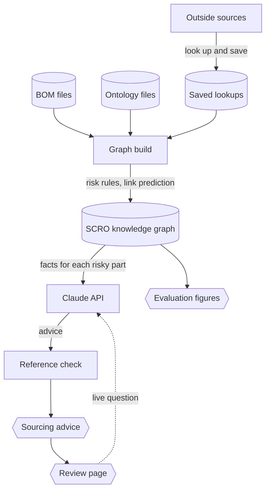
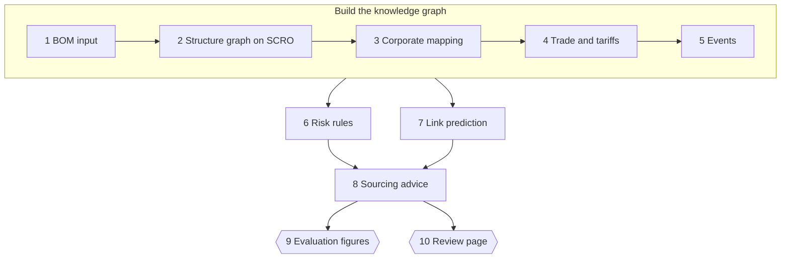

# An Industry Agnostic Ontology Framework for Supply Chain Resilience and Procurement Decision Support

MSc dissertation project, University of Hull, 2026.

This project builds a knowledge graph of a product's supply chain on a standard ontology and uses it to advise a buyer. It starts from a bill of materials (BOM), adds suppliers, owners, tariffs and disruption events, rates each part for risk, predicts supply links that are not on record, and ends with a purchasing strategy for every part at risk. It is tested on two products from different sectors: the Skydio X10 drone and the Fairphone 4 smartphone.

Everything runs from one notebook, `Project UAT.ipynb`.

## How it works



The work runs in four stages.

1. **Data extraction.** The BOM files are read, and company owners, duty rates, disruption reports and customs bills are looked up from outside sources. Every answer is saved in a data folder, so the notebook runs from the saved lookups.
2. **SCRO knowledge graph.** Each product becomes one graph built on the IOF Supply Chain Reference Ontology (SCRO), IOF Core and BFO. Owners, tariffs, events, risk findings and predicted supply links are added to it.
3. **LLM over the graph.** For each part with a risk finding, its facts are taken from the graph and given to Claude, which writes the advice. Each instruction is then checked against the records it cites.
4. **Procurement strategy and recommendation.** The accepted advice gives a purchasing strategy and the suppliers for each part, shown on a review page with the rest of the graph.

## The ten steps



| Step | What it covers |
|---|---|
| 1 | BOM input |
| 2 | Structure graph on SCRO 202603 |
| 3 | Corporate mapping (GLEIF, Wikidata, OpenCorporates, documented parents) |
| 4 | Trade and tariffs (US and EU duties) |
| 5 | Events (a typed event library and a news feed, read and judged by Claude) |
| 6 | Risk rules (seven rules, findings written into the graph) |
| 7 | Link prediction (ImportYeti links, a published method and an adapted model, predictions in the graph) |
| 8 | Sourcing advice (a purchasing strategy for every item with a risk finding) |
| 9 | Evaluation figures (six plots, saved in `figures/`) |
| 10 | Review page (one page with nine tabs for everything steps 2 to 9 produced) |

## How to run it

The notebook was built and run with Python 3.13.

1. Install the packages:

   ```
   pip install -r requirements.txt
   ```

2. Create a file named `.env` beside the notebook with these three names. The keys themselves are not in this repository.

   ```
   ANTHROPIC_API_KEY=
   IMPORTYETI_API_KEY=
   OPENCORPORATES_API_KEY=
   ```

3. Open `Project UAT.ipynb`, choose the product in section 1.1 (`CASE = "skydio_x10"` or `CASE = "fairphone4"`), and run all cells. A full run takes a few minutes.

4. Open `preview/skydio_x10_graph_preview.html` or `preview/fairphone4_graph_preview.html` in a browser to see the review page. To use its question box as well, open http://localhost:8765 while the notebook is running.

### Settings

| Setting | Where | What it does |
|---|---|---|
| `CASE` | Section 1.1 | The product to run |
| `PULL` | Section 3.1 | `False` reuses the saved lookups. `True` looks up whatever is not saved yet |
| `PULL` | Section 7.4 | `False` buys nothing. `True` buys ImportYeti bills, which costs credits, and asks Claude again for advice |
| `REPEAT_AGAIN` | Section 9.1 | `False` reuses the saved scores. `True` trains the link prediction models again, which takes several minutes |

With both `PULL` settings at `False` the notebook makes no paid calls. The ImportYeti name must still be present in `.env`, because step 7 reads it when it starts. The question box on the review page sends each question to Claude through the notebook, so it needs the Anthropic key. The key stays in the notebook and is never written into the page.

## What is in each folder

| Path | What it holds |
|---|---|
| `Project UAT.ipynb` | The notebook: all ten steps |
| `skydio_x10.bom.json`, `fairphone4_enriched_v0_2.bom.json` | The two bills of materials |
| `ontology/` | SCRO, IOF Core and BFO, and `our_terms.ttl` with the ten terms added by this project |
| `corporate_data/` | Step 3: saved company lookups and hand-checked parents |
| `trade_data/` | Step 4: tariff codes and saved duty rates |
| `event_data/` | Step 5: event sources, news screening and the event library |
| `importyeti_data/` | Step 7: purchased customs bills and the clean link table |
| `link_prediction_data/` | Step 7: training examples, saved scores and predictions |
| `sourcing_data/` | Step 8: the advice and the list of vetted alternative makers |
| `graphs/` | The graph of each step and product, as Turtle files |
| `figures/` | The figures drawn in steps 2 and 9, and a picture of how the system works |
| `preview/` | The review page template and the page built for each product |
| `requirements.txt` | The Python packages needed |

Each data folder has its own `README.txt` describing its files.

## Data sources and credits

- Ontologies: IOF Supply Chain Reference Ontology (release 202603) and IOF Core from the Industrial Ontologies Foundry, and Basic Formal Ontology (BFO).
- Customs bills of lading: ImportYeti, through its paid API.
- Company records: GLEIF, Wikidata and OpenCorporates (opencorporates.com).
- Duty rates: the UK Trade Tariff service for UK and EU rates, and the US Harmonized Tariff Schedule.
- Vetted alternative drone part makers: the Blue UAS Framework list.
- Language models: Claude, through the Anthropic API, for reading events and writing advice; `all-MiniLM-L6-v2` from sentence-transformers for link prediction.
- Link prediction method: Zheng and Brintrup (2025), "Enhancing supply chain visibility with generative AI", International Journal of Production Research.
